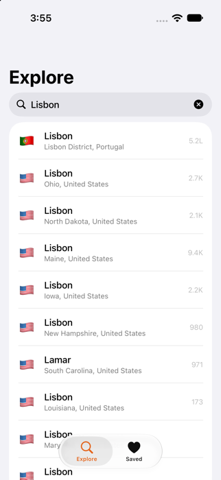
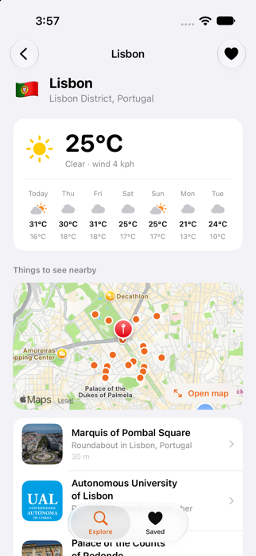
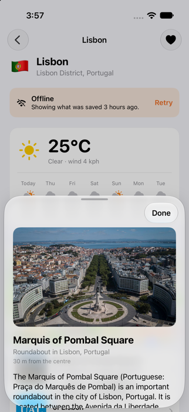
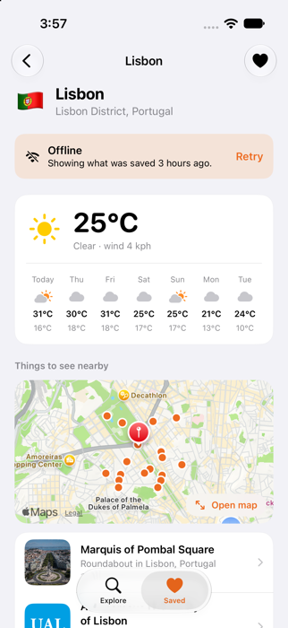

# Roam

A place explorer for iPhone. Search any city, see its 7-day forecast, a map and the landmarks around it, and save
places so they still open on a plane. It runs on free public APIs with no key and no account.

<table>
  <tr>
    <td></td>
    <td></td>
    <td></td>
    <td></td>
  </tr>
</table>

## Features

- **Search** with a debounce: nothing is sent while you are typing, and only the latest search can update the screen.
- **Place detail**: current weather and a 7-day forecast, a map of the landmarks, and a ranked list with photos.
- **Landmark sheet**: photo, summary, distance, Directions in Apple Maps and a link to the Wikipedia article.
- **Saved places** open without a connection. A banner says the data is old ("Showing what was saved 3 hours
  ago") and offers Retry; pull to refresh when you are back online.
- **Recent places**, your region's units (°C or °F, km or miles), dark mode, VoiceOver labels.

## Where the data comes from

| Data | Source |
| --- | --- |
| City search | [Open-Meteo geocoding](https://open-meteo.com/en/docs/geocoding-api) |
| Weather | [Open-Meteo forecast](https://open-meteo.com/en/docs) |
| Landmarks, photos, summaries | [Wikipedia geosearch](https://www.mediawiki.org/wiki/API:Geosearch) |

Wikipedia text and images are free-licensed; the app credits them in the landmark sheet. Open-Meteo is free for
non-commercial use.

## Build and run

Needs a Mac with Xcode. Developed with Xcode 27 (Swift language mode 5); deployment target iOS 17. There is nothing
to configure: no API keys.

```bash
brew install xcodegen
git clone <this repo>
cd Roam
xcodegen generate
open Roam.xcodeproj
```

To try the offline behaviour in the simulator, open a place, then add `-simulateOffline` to the scheme's launch
arguments (Debug builds only): every request fails the way airplane mode does, and the app falls back to what it saved.

## Tests

The whole data layer is a Swift package with no UI, and the tests never touch the network:

```bash
cd Packages/RoamCore
swift test        # 57 tests
```

They decode **real API responses** (saved under `Tests/RoamCoreTests/Fixtures`), and drive the client and cache with a
mock `HTTPClient`, a `URLProtocol` stub and a clock the test advances by hand. They cover: URLs that cannot be
injected into by a search query; missing, null and ragged fields in the JSON; which errors are retried and for how
long (backoff, `Retry-After`, giving up, never retrying "offline" or a 404); cache hits, expiry, stale fallback, a
corrupt cache file, a bad response never being cached, and cancellation never being mistaken for a network failure.

## How the code is organised

```
Roam/                    The app target
  RoamApp.swift          Entry point
  Data/                  Network and cache setup, view models (search, place detail), saved and recent places
  UI/                    Tabs, Explore, Place detail, Landmark sheet and full map, Saved, shared components
  Support/               Formatting (units, dates), theme, map region
  Dev/                   Offline simulation for `-simulateOffline` (Debug builds only)
Packages/RoamCore/       The data layer, as a package
  Endpoints.swift        The three requests, built with URLComponents
  Decoding.swift         Wire formats -> app models (private to this file)
  Network.swift          HTTPClient, URLSession client, retry with backoff, error type
  Cache.swift            Memory and disk response caches
  CachedFetcher.swift    Network with a cache behind it, and the "stale but better than nothing" fallback
  AttractionRanker.swift Which Wikipedia pages are worth showing
  RoamService.swift      What the app calls, with a time-to-live per kind of data
docs/screenshots/        Images used in this README
project.yml              XcodeGen definition (the .xcodeproj is generated, not committed)
```

Design notes:

- **Layers you can swap.** `HTTPClient` is a protocol, `RetryingClient` is a decorator around it, and the cache sits
  behind `CachedFetcher`. Tests plug in fakes at each seam; the app plugs in `URLSession`.
- **Stale beats nothing.** A fresh cached copy is used without a request. An expired copy triggers a request, and
  if that fails the expired copy is returned *marked stale*, so the screen can say so instead of showing an error.
- **Each kind of data has its own lifetime.** Place names: 7 days. Landmarks: 7 days. Forecast: 30 minutes.
- **The cache stores raw responses**, not decoded models, so improving the ranking or the decoder applies to
  places that are already saved.
- **The timestamp is the file's modification date**, so the disk cache has no index to keep in step with the files.
- **Decoding is defensive.** The forecast's parallel arrays can hold nulls or be shorter than expected; a day with
  missing data is dropped instead of showing zeros, and an API that returns no `results` key means "no matches".
- **Wikipedia's results need curating.** Geosearch returns every article with coordinates, including politicians
  born nearby and medieval kingdoms. The ranker drops those by description, removes the place's own article,
  and puts pages with a photo and a description first.
- **No location permission.** The app never asks for the user's location; places come from search.

## What has and hasn't been tested

- Checked in the iOS 27 Simulator against the live APIs: search, opening a place, weather, map, landmark sheet,
  saving, the Saved tab, and the offline fallback (simulated with `-simulateOffline` and with cache files aged by
  hand to exercise the stale banner).
- **Not tested:** a physical iPhone, real airplane mode or a flaky mobile connection, iOS versions other than 27,
  search for non-Latin place names beyond the URL encoding being unit-tested, and large cities with thousands of
  Wikipedia articles (the app asks for the 30 nearest).
- Landmark quality depends on Wikipedia's data. In small towns the list can be short or odd, and the filter is
  a keyword heuristic, not a classifier.

## License

[MIT](LICENSE)
